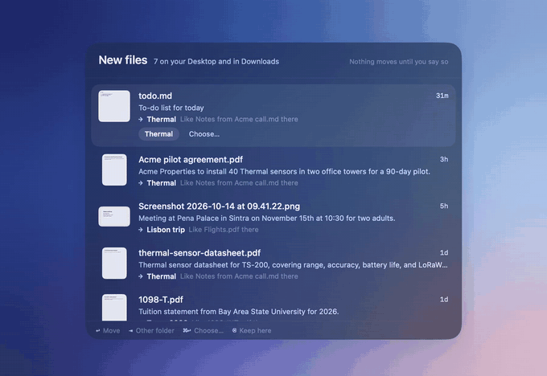

<p align="center">
  
</p>

<h1 align="center">Trail</h1>

<p align="center">
  <b>Your Mac as a private knowledge graph.</b><br>
  Ask for any file in plain words. Give the stuff piling up on your Desktop a home.<br>
  Press <kbd>⌥</kbd><kbd>Space</kbd>. Everything runs on your Mac.
</p>

<p align="center">
  <a href="https://github.com/uneasymusings/trail/actions/workflows/ci.yml"></a>
  <a href="https://github.com/uneasymusings/trail/releases/latest"></a>
  
  
  
  <a href="LICENSE"></a>
</p>

<p align="center">
  
</p>

Trail lives in your menu bar and keeps a graph of your files:
- which project each one belongs to;
- its earlier versions;
- where it came from, and what's inside it;
- what you were working on when it changed.

A small model runs on your Mac (Apple's on-device Foundation Model). It reads your question and **chooses the answer from the graph**, so it finds the file you mean and can't make one up.

- *"What's the latest pitch deck for Thermal?"* → `Pitch v3.key`, newest of three versions
- *"That big file I downloaded about the lease a few weeks ago"* → `Scan 2026-09-02.pdf`, a scan whose name says nothing
- *"My Blender stuff"* → your `.blend` scenes, not every 3D model you've downloaded
- *"thermla pitch"* → "Showing results for **thermal pitch**"

<table>
  <tr>
    <td width="58%"></td>
    <td>
      <b>A home for every new file.</b><br>
      Screenshots and downloads pile up. Trail reads each new one (on-device OCR for screenshots) and finds where files like it already live. It remembers where you put similar files before. Then it suggests a folder, with a reason. The menu bar shows a quiet count, not notifications.
      <br><br>
      <kbd>↩</kbd> moves it, <kbd>⇥</kbd> picks another folder, <kbd>⌫</kbd> keeps it where it is, and <kbd>⌘</kbd><kbd>Z</kbd> undoes. <b>Nothing moves until you say so.</b>
    </td>
  </tr>
  <tr>
    <td></td>
    <td>
      <b>See the graph.</b><br>
      The Map shows your active projects and their newest files, and the topics they share. It also shows the sites your downloads came from, and which projects you work on together. Hover a project to see what it touches, click to open it.
    </td>
  </tr>
  <tr>
    <td></td>
    <td>
      <b>Instant, then smart.</b><br>
      Results appear as you type, in 2–17 ms, from names, folders and the text inside your documents. Typos get fixed, and app names mean their files. For a real question, the model takes about a second to read it and choose. <kbd>⇥</kbd> shows a file's neighborhood: versions, files edited alongside it, shared topics.
    </td>
  </tr>
  <tr>
    <td></td>
    <td>
      <b>Quiet by design.</b><br>
      No Dock icon, no windows on launch. Scanning and reading run on efficiency cores. Notes are only written while you're away from the keyboard. A small note fades in once and gets out of the way.
    </td>
  </tr>
</table>

## How it thinks

```
  "that big file I downloaded
   a couple of days ago"
          │
          ▼
  rules parse it (0.1 ms)            downloaded · 1–3 days ago · biggest first
          │
          ▼
  graph search (2–17 ms)             SQLite FTS5 over names, folders and document text,
          │                          ranked by match, name, kind, recency and your habits
          ├──► results on screen
          ▼
  on-device model (~1 s)             reads the question + facts about the top 8 files
          │                          (kind, age, folder, project, versions, source, notes)
          ▼
  answers with a number              so it can choose a file, never invent one  ✦
```

Every guardrail came from a real failure. The model may not turn "blender" into "any 3D file". The "two" in "two days ago" may not become a search word. A real English word is never "corrected" into something else. Details in [docs/ARCHITECTURE.md](docs/ARCHITECTURE.md).

## Measured, not guessed

Search quality has a benchmark: `swift test --filter SearchQuality`. It asks 56 everyday questions of a messy made-up home folder, which contains:
- a code project full of files named like the questions;
- a cluttered Downloads folder;
- scans called `document (3).pdf`;
- Blender scenes next to newer generic 3D downloads.

The questions cover plain names, app names, half-typed words, typos, rambling questions and things only inside documents.

| | 0.2.0 | 0.3.0 |
|---|---|---|
| Right file first | 22 / 48 | **55 / 56** |
| Right file in the top 3 | 33 / 48 | **56 / 56** |
| Search as you type, on a real Mac with 49,700 files | 5 ms (names only) | 2–17 ms (names and text) |
| Memory while watching | 41–308 MB | 31 MB |

The one miss is kept on purpose. "lease" ranks a code component named `Lease.tsx` above the lease agreement, which comes third.

## Install

Requires macOS 26 (Tahoe) on Apple silicon. Apple Intelligence is optional: without it, Trail still searches, reads documents and suggests folders, but doesn't write notes or choose between results.

```sh
brew install --cask uneasymusings/trail/trail
```

or

```sh
curl -fsSL https://raw.githubusercontent.com/uneasymusings/trail/main/scripts/install.sh | bash
```

Then grant **Full Disk Access** in System Settings → Privacy & Security, so Trail can see Desktop, Documents, Downloads and iCloud Drive without asking folder by folder.

> Releases aren't notarized yet. Homebrew's copy shows macOS's "unidentified developer" warning the first time: choose **Open Anyway** in System Settings → Privacy & Security. The install script and source builds don't hit this. After each update, macOS treats the app as new, so turn Full Disk Access back on for it.

### Build from source

```sh
git clone https://github.com/uneasymusings/trail && cd trail
make setup        # checks for Xcode 26, installs XcodeGen
make install      # builds, signs ad hoc, copies to /Applications
```

`make install TEAM=ABCDE12345` signs with your Apple Development team instead, which adds the desktop widget: macOS only shares data with widgets from apps signed by a real team. Your team ID is the `OU` field of your Apple Development certificate. Run `make` on its own to see every target.

## Use it

**Search** with <kbd>⌥</kbd><kbd>Space</kbd>:

| Key | Does |
|---|---|
| <kbd>↑</kbd> <kbd>↓</kbd> | Move through results |
| <kbd>↩</kbd> | Open the file |
| <kbd>⌘</kbd><kbd>↩</kbd> | Show it in Finder |
| <kbd>⇥</kbd> | Related: versions, files edited in the same session, shared topics, same project |
| <kbd>⇧</kbd><kbd>⌘</kbd><kbd>C</kbd> | Copy the path |
| <kbd>esc</kbd> | Clear, then close |

**Sort.** When new files are waiting, the menu bar shows a count. Click it, or the line at the top of the search panel:

| Key | Does |
|---|---|
| <kbd>↩</kbd> | Move to the suggested folder |
| <kbd>⇥</kbd> | Next suggestion |
| <kbd>⌘</kbd><kbd>↩</kbd> | Choose any folder |
| <kbd>⌫</kbd> | Keep it where it is (Trail stops asking) |
| <kbd>⌘</kbd><kbd>Z</kbd> | Put the last one back |

Files only count after they've sat for 10 minutes, so the screenshot you're about to paste isn't flagged. Turn suggestions off in Settings → New files.

**Map.** Menu bar → Map.

**Widget.** Right-click the desktop → Edit Widgets → Trail. It shows the latest file in each recent project, with an **Ask** button.

**Links and Shortcuts.** `trail://ask?q=invoice` opens the panel with a query. `trail://sort` opens the sort panel and `trail://map` the map. `trail://open?path=…` and `trail://reveal?path=…` open or reveal an indexed file.

### Command line

```sh
make install-cli              # copies `trail` to ~/.local/bin
```

```console
$ trail ask "the deck we're sending to investors"
keywords: investors · kind: presentation · read by model · chosen by model · 1195 ms

→ Pitch v3.key — 3 hours ago in Thermal (newest of 3 versions)

$ trail inbox
Acme pilot agreement.pdf  ~/Downloads · arrived 3 hours ago
  Pilot agreement: Acme Properties and Thermal. Acme Properties will install 40 Thermal sensors…
  → ~/Documents/Thermal  Like Notes from Acme call.md there · chosen by model

Screenshot 2026-10-14 at 09.41.22.png  ~/Desktop · arrived 5 hours ago
  Tickets confirmed. Pena Palace, Sintra. Saturday, November 15…
  → ~/Documents/Lisbon trip  Like Flights.pdf there
```

`trail find` (instant, no model), `trail recent`, `trail projects`, `trail related <file>`, `trail stats` and `trail compact` work the same way. The CLI and the app share one index in `~/Library/Application Support/Trail`. Set `TRAIL_HOME` to keep a separate one.

## How it works

```
 FSEvents (home folder) ─► filter + batch ─► graph (SQLite + FTS5) ◄─ on-device model
                                                  │  ▲                 (notes, tags, choosing)
                                                  │  └─ document reader (first 6,000 characters)
                                                  ▼
                       ⌥Space panel · sort panel · map · widget · CLI
```

- **Watching.** One FSEvents stream covers your home folder, including iCloud Drive and Dropbox. Events are batched every 1.5 s. Trail stores the last event ID, so after a restart it replays only what changed while it was closed.
- **Projects.** A git repository or package folder counts as a project. Otherwise the first folder under Documents, Desktop, iCloud and similar places does, so `~/Documents/Taxes 2026/W-2.pdf` belongs to "Taxes 2026".
- **Versions.** `Pitch v2.key`, `Pitch (1).key`, `pitch_final.key` and `Pitch 2026-10-14.key` are linked into one chain. Search shows the newest, unless you ask for "pitch v2".
- **Origin.** Downloads are recognized by their source URL or the app that brought them in. Files saved by AI tools (Claude, ChatGPT, Cursor and others) are recognized by app and folder. macOS doesn't record which process wrote a file, so this is a best guess.
- **Generated output.** A folder of hundreds of renders, screenshots or test artifacts becomes one entry, like "thermal-hero: 48 files, mostly PNG images", so it can't bury your real work.
- **Reading.** In the background, Trail reads the start of each PDF, Word file, text file, slide deck and spreadsheet into a full-text index, newest first, and reads it again when it changes.
- **Search.** A rule-based parser turns the question into a plan on every keystroke: keywords, kind, time window, origin, size and newest-first. SQLite FTS5 with stemming finds files with every word in the name, the folders or the text. They're ranked on:
  - text match;
  - how many of your words the name contains;
  - kind: a document beats a source file of the same name;
  - recency;
  - how often you open the file from Trail.

  Filters that would leave nothing are loosened.
- **Asking.** Questions of 3 or more words go to the model twice. First it shapes the search. Then it reads the top 8 results and chooses one by number.
- **Sorting.** New loose files on the Desktop and in Downloads are read and matched against the graph. Votes come from where similar files live, what you were doing when the file arrived, and where you put files like it before. The model chooses among those real folders.

The details, with schema, ranking weights and trade-offs, are in [docs/ARCHITECTURE.md](docs/ARCHITECTURE.md).

## Numbers

Measured on a developer's MacBook Pro (M-series) with a busy home folder:

| | |
|---|---|
| Files on disk under `~` | about 400,000 |
| Entries in the graph | 49,700 in 107 projects (generated output folded into single entries) |
| Index size | 40 MB, including the text of 4,000 documents |
| First scan | about 90 s at normal priority (longer at background priority, on purpose) |
| Search as you type | 2–17 ms |
| Model-read questions | about 1.2 s more; instant results show first |
| Suggesting folders for new files | about 0.4 s each with the model, in the background |
| Reading documents | about 4,700 documents in a few minutes, in the background, once |
| Notes | about 1.5 s per file, only after a minute away from the keyboard, never on low power |
| App size | 7 MB |
| Memory | 31 MB footprint while watching; about 230 MB for a few seconds at a time while it reads text in screenshots |

## Privacy

- The index lives only in `~/Library/Application Support/Trail`. Delete that folder and Trail forgets everything.
- Trail makes no network calls. The model runs on your Mac through Apple's Foundation Models framework.
- To search inside documents it reads the first 6,000 characters of PDFs, Word, text, slide and spreadsheet files. The index keeps the words, not a copy of the files, but it can still reveal what they say, so treat it as being as private as the documents themselves.
- For notes and folder suggestions it reads at most the first few kilobytes of documents and screenshots (with on-device text recognition). It never reads code or data files.
- It never moves, renames or deletes a file unless you press a key in the sort panel.
- It skips caches, hidden folders, `node_modules`, build output, app bundles and `~/Library` (except iCloud Drive and cloud-storage folders). Add more under Settings → Folders.

## Project layout

```
Sources/TrailCore/   the engine: watcher, indexer, graph, search, inbox, map, model (Swift package, no dependencies)
Sources/trail/       the CLI
Tests/               Swift Testing suites, including the search benchmark
App/                 menu-bar app: search panel, sort panel, map, settings, widget (XcodeGen project.yml)
scripts/             icon, DMG, install, and demo recording (scripts/demo)
docs/                architecture notes and README media
```

## Contributing

Bug reports and pull requests are welcome. [CONTRIBUTING.md](CONTRIBUTING.md) covers:
- setup and tests;
- the search benchmark;
- how the demo GIFs are recorded against a made-up home folder;
- how releases work.

## Roadmap

- [ ] Suggested names for screenshots ("Sintra tickets.png"), alongside the suggested folder
- [ ] An end-of-day nudge when files have been waiting a while
- [ ] A downloadable fallback model (LFM2.5-350M via llama.cpp) for Macs without Apple Intelligence
- [ ] Semantic search with on-device embeddings
- [ ] Watching external drives
- [ ] Notarized releases

## License

[MIT](LICENSE)
