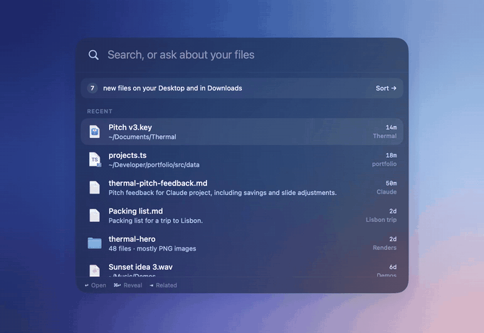

<p align="center">
  
</p>

<h1 align="center">Trail</h1>

<p align="center">
  A private map of the files on your Mac. Press <kbd>⌥</kbd><kbd>Space</kbd> and ask.
</p>

<p align="center">
  <a href="https://github.com/uneasymusings/trail/actions/workflows/ci.yml"></a>
  <a href="https://github.com/uneasymusings/trail/releases/latest"></a>
  
  
  <a href="LICENSE"></a>
</p>

<p align="center">
  
</p>

Trail watches your Mac and keeps a small knowledge graph of your files: which project each one belongs to, its earlier versions, where it came from, and what it's about. Then it answers the questions you actually have:

- *"What's the latest pitch deck for Thermal?"*
- *"PDFs I downloaded about taxes"*
- *"What was I working on today?"*

Results appear as you type, in about 5 ms. A tiny on-device model (Apple's Foundation Model) reads longer questions and writes one-line notes about your documents while the Mac is idle. Nothing leaves your Mac.

## Why

Finder search matches names. Spotlight matches everything. Neither knows that `Pitch v3.key` replaced `Pitch (1).key` and `pitch_final.key`. Neither knows the file came from Safari last Tuesday, or that you edited it alongside `projects.ts`. Trail keeps that context in a graph and stays out of the way until you press a key.

<table>
  <tr>
    <td width="60%"></td>
    <td>
      <b>Ask like you'd ask a person.</b><br>
      "Downloaded", "last week", "deck" and "latest" become filters. Plurals match. If you type 3 or more words, the on-device model reads the question too. The rule-based answer always shows first, so you never wait on the model.
      <br><br>
      <b>Pick up where you left off.</b><br>
      "What was I working on today?" summarizes your projects in one line.
    </td>
  </tr>
  <tr>
    <td></td>
    <td>
      <b>Quiet by design.</b><br>
      No Dock icon, no windows on launch. The first scan runs on efficiency cores. A small note fades in once and then gets out of the way.
    </td>
  </tr>
</table>

## Install

Requires macOS 26 (Tahoe) on Apple silicon. Apple Intelligence is optional: without it, Trail still searches but doesn't write notes.

```sh
brew install --cask uneasymusings/trail/trail
```

or

```sh
curl -fsSL https://raw.githubusercontent.com/uneasymusings/trail/main/scripts/install.sh | bash
```

Then grant **Full Disk Access** in System Settings → Privacy & Security, so Trail can see Desktop, Documents, Downloads and iCloud Drive without asking folder by folder.

> Releases aren't notarized yet. Homebrew's copy shows macOS's "unidentified developer" warning the first time: choose **Open Anyway** in System Settings → Privacy & Security. The install script and source builds don't hit this. After each update, macOS treats the app as new, so turn Full Disk Access back on for it.

### Build from source

```sh
git clone https://github.com/uneasymusings/trail && cd trail
make setup        # checks for Xcode 26, installs XcodeGen
make install      # builds, signs ad hoc, copies to /Applications
```

`make install TEAM=ABCDE12345` signs with your Apple Development team instead, which adds the desktop widget: macOS only shares data with widgets from apps signed by a real team. Your team ID is the `OU` field of your Apple Development certificate. Run `make` on its own to see every target.

## Use it

| Key | Does |
|---|---|
| <kbd>⌥</kbd><kbd>Space</kbd> | Open or close the panel (change it in Settings) |
| <kbd>↑</kbd> <kbd>↓</kbd> | Move through results |
| <kbd>↩</kbd> | Open the file |
| <kbd>⌘</kbd><kbd>↩</kbd> | Show it in Finder |
| <kbd>⇥</kbd> | Related: versions, files edited in the same session, shared topics, same project |
| <kbd>⇧</kbd><kbd>⌘</kbd><kbd>C</kbd> | Copy the path |
| <kbd>esc</kbd> | Clear, then close |

**Widget.** Right-click the desktop → Edit Widgets → Trail. It shows the latest file in each recent project, with an **Ask** button.

**Links and Shortcuts.** `trail://ask?q=invoice` opens the panel with a query. `trail://open?path=…` and `trail://reveal?path=…` open or reveal an indexed file.

### Command line

```sh
make install-cli              # copies `trail` to ~/.local/bin
```

```console
$ trail ask "latest pitch deck for thermal"
keywords: thermal, pitch · kind: presentation · newest first · read by model · 1158 ms

→ Pitch v3.key — 15 minutes ago in Thermal (newest of 3 versions)

▸ Thermal project · 7 files · active 15 minutes ago

  Pitch v3.key  15 minutes ago · Thermal · 3 versions
  ~/Documents/Thermal
```

`trail find` (instant, no model), `trail recent`, `trail projects`, `trail related <file>`, `trail stats` and `trail compact` work the same way. The CLI and the app share one index in `~/Library/Application Support/Trail`. Set `TRAIL_HOME` to keep a separate one.

## How it works

```
 FSEvents (home folder) ─► filter + batch ─► graph (SQLite + FTS5) ◄─ on-device model, idle only
                                                  │                     (one-line notes, tags)
                                                  ▼
                                   ⌥Space panel · widget · CLI
```

- **Watching.** One FSEvents stream covers your home folder, including iCloud Drive and Dropbox. Events are batched every 1.5 s. Trail stores the last event ID, so after a restart it replays only what changed while it was closed.
- **Projects.** A git repository or package folder counts as a project. Otherwise the first folder under Documents, Desktop, iCloud and similar places does, so `~/Documents/Taxes 2026/W-2.pdf` belongs to "Taxes 2026".
- **Versions.** `Pitch v2.key`, `Pitch (1).key`, `pitch_final.key` and `Pitch 2026-10-14.key` are linked into one chain, and search shows the newest.
- **Origin.** Downloads are recognized by their source URL or the app that brought them in. Files saved by AI tools (Claude, ChatGPT, Cursor and others) are recognized by app and folder. macOS doesn't record which process wrote a file, so this is a best guess.
- **Generated output.** A folder of hundreds of renders, screenshots or test artifacts becomes one entry, like "thermal-hero: 48 files, mostly PNG images", so it can't bury your real work.
- **Search.** A rule-based parser turns the question into a plan (keywords, kind, time window, origin, newest-first) on every keystroke. SQLite FTS5 with stemming finds candidates, then ranking blends relevance with recency. Longer questions also go to the model, which returns a structured plan. Its guesses are checked: a time window you never mentioned is dropped.

The details, with schema and trade-offs, are in [docs/ARCHITECTURE.md](docs/ARCHITECTURE.md).

## Numbers

Measured on a developer's MacBook Pro (M-series) with a busy home folder:

| | |
|---|---|
| Files on disk under `~` | about 400,000 |
| Entries in the graph | 49,242 in 107 projects (generated output folded into single entries) |
| Index size | 33 MB |
| First scan | about 90 s at normal priority (longer at background priority, on purpose) |
| Search as you type | 5–6 ms |
| Model-read questions | 1–2 s more; instant results show first |
| Notes | about 1.5 s per document, only while idle and not on low power |
| App size | 5.2 MB |
| Memory | 41 MB footprint while watching |

## Privacy

- The index lives only in `~/Library/Application Support/Trail`. Delete that folder and Trail forgets everything.
- Trail makes no network calls. The model runs on your Mac through Apple's Foundation Models framework.
- For notes it reads at most the first few kilobytes of documents, PDFs, slides and screenshots (with on-device text recognition). It never reads code or data files.
- It skips caches, hidden folders, `node_modules`, build output, app bundles and `~/Library` (except iCloud Drive and cloud-storage folders). Add more under Settings → Folders.

## Project layout

```
Sources/TrailCore/   the engine: watcher, indexer, graph, search, model (Swift package, no dependencies)
Sources/trail/       the CLI
Tests/               Swift Testing suites
App/                 menu-bar app, search panel, settings, widget (XcodeGen project.yml)
scripts/             icon, DMG, install, and demo recording (scripts/demo)
docs/                architecture notes and README media
```

## Contributing

Bug reports and pull requests are welcome. [CONTRIBUTING.md](CONTRIBUTING.md) covers setup, tests, how the demo GIFs are recorded against a made-up home folder, and how releases work.

## Roadmap

- [ ] A downloadable fallback model (LFM2.5-350M via llama.cpp) for Macs without Apple Intelligence
- [ ] Semantic search with on-device embeddings
- [ ] A visual graph view of projects and their files
- [ ] Watching external drives
- [ ] Notarized releases

## License

[MIT](LICENSE)
